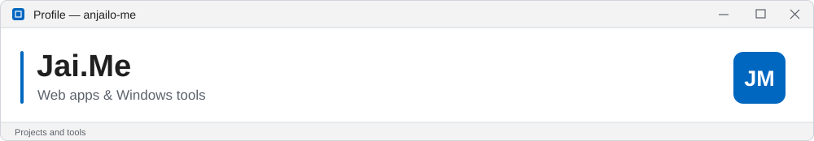

<picture><source media="(max-width: 600px) and (prefers-color-scheme: dark)" srcset="assets/windows/header-mobile-dark.svg"><source media="(max-width: 600px)" srcset="assets/windows/header-mobile-light.svg"><source media="(prefers-color-scheme: dark)" srcset="assets/windows/header-dark.svg"></picture>

I build web apps and Windows tools.

### Tech stack

<picture><source media="(prefers-color-scheme: dark)" srcset="assets/windows/javascript-dark.svg"></picture>
<picture><source media="(prefers-color-scheme: dark)" srcset="assets/windows/html-dark.svg"></picture>
<picture><source media="(prefers-color-scheme: dark)" srcset="assets/windows/css-dark.svg"></picture>
<picture><source media="(prefers-color-scheme: dark)" srcset="assets/windows/nodejs-dark.svg"></picture>
<picture><source media="(prefers-color-scheme: dark)" srcset="assets/windows/electron-dark.svg"></picture>
<picture><source media="(prefers-color-scheme: dark)" srcset="assets/windows/dotnet-dark.svg"></picture>

JavaScript · HTML · CSS · Node.js · Electron · .NET

### Projects

- **[Relay](https://github.com/anjailo-me/relay-download-manager)** — Windows download manager. [Download EXE](https://github.com/anjailo-me/relay-download-manager/releases/latest)
- **[Wi-Fi Speed Widget](https://github.com/anjailo-me/wifi-speed-widget)** — Desktop connection and speed monitor.
- **[LycaBooth](https://github.com/anjailo-me/lycabooth)** — Browser photo booth.
- **[Tagay](https://github.com/anjailo-me/tagay)** — A shot counter for the barkada.

[All repositories →](https://github.com/anjailo-me?tab=repositories)
