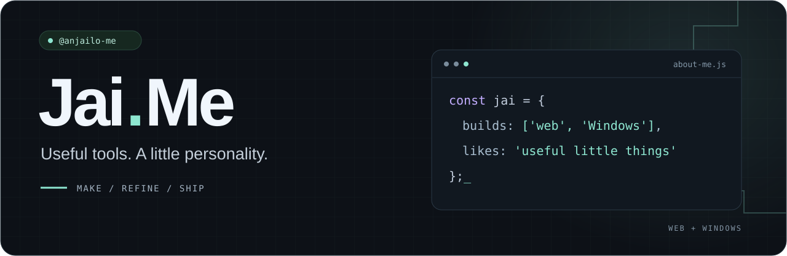
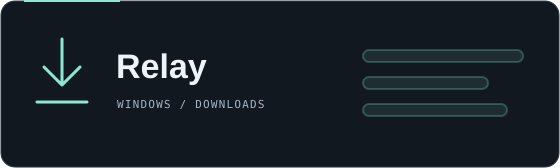
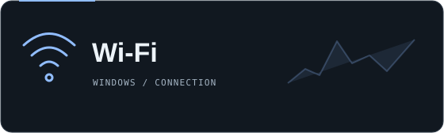
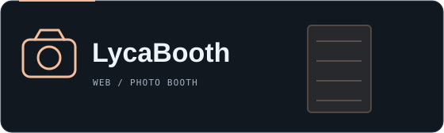
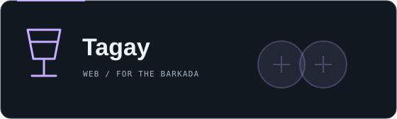

  I’m <b>Jai.Me</b>, also known as <b>anjailo-me</b>. 
  I build browser apps and Windows tools with clear interfaces and a little character.

  <a href="https://github.com/anjailo-me?tab=repositories">Explore my projects</a>
  &nbsp; · &nbsp;
  <a href="https://github.com/anjailo-me/relay-download-manager">See what I’m building</a>

### Selected projects

<table>
  <tr>
    <td width="50%" valign="top">
      
      <h3><a href="https://github.com/anjailo-me/relay-download-manager">Relay</a></h3>
      
A Windows download manager with browser integration, queues, pause/resume, and file-size previews.

      
JavaScript · Node.js · Electron

      <a href="https://github.com/anjailo-me/relay-download-manager">Source</a> &nbsp; / &nbsp; <a href="https://github.com/anjailo-me/relay-download-manager/blob/main/docs/windows-release.md">Build notes</a>
    </td>
    <td width="50%" valign="top">
      
      <h3><a href="https://github.com/anjailo-me/wifi-speed-widget">Wi-Fi Speed Widget</a></h3>
      
A small Windows widget for speed tests, ping, jitter, packet loss, and connection history.

      
.NET · Windows desktop

      <a href="https://github.com/anjailo-me/wifi-speed-widget">Source</a> &nbsp; / &nbsp; <a href="https://github.com/anjailo-me/wifi-speed-widget/releases/latest">Download</a>
    </td>
  </tr>
  <tr>
    <td width="50%" valign="top">
      
      <h3><a href="https://github.com/anjailo-me/lycabooth">LycaBooth</a></h3>
      
An analog-style browser photo booth with filters, stickers, and downloadable photo strips.

      
JavaScript · HTML · CSS

      <a href="https://github.com/anjailo-me/lycabooth">Explore the project →</a>
    </td>
    <td width="50%" valign="top">
      
      <h3><a href="https://github.com/anjailo-me/tagay">Tagay</a></h3>
      
A shot counter for the barkada. Add names, keep score, and pick up where you left off.

      
Browser app · Local storage

      <a href="https://github.com/anjailo-me/tagay">Explore the project →</a>
    </td>
  </tr>
</table>

### Toolbox

`JavaScript` &nbsp; `HTML / CSS` &nbsp; `Node.js` &nbsp; `Electron` &nbsp; `.NET`

 

Small ideas. Working apps. Room for a little fun.

